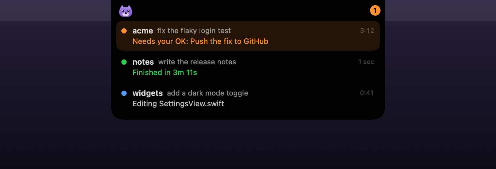
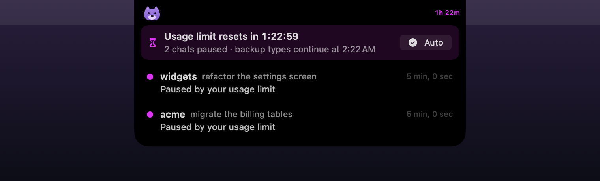

# Buddy

Buddy is a small companion for Claude Code that lives in your MacBook notch. It shows what each Claude Code session is doing, and it opens when a session needs you.



Buddy is an independent open-source project by Purplelink LLC. It is not made by, affiliated with, or endorsed by Anthropic. Claude and Claude Code are trademarks of Anthropic.

## What it does

- **Working:** a little character sits beside the notch and glances around while Claude works. A blue dot (and a count) shows how many sessions are busy.
- **Needs you:** when a session asks for permission, asks a question, or has a plan for you to review, Buddy hops, plays a sound, and opens for 20 seconds. After that an orange badge stays until you answer.
- **Finished:** Buddy smiles, plays a chime, and says how long the turn took ("Finished in 3m 12s"). A green check stays until you hover the notch.
- **Jump to it:** click a session to open that exact chat in the Claude app, that exact Terminal or iTerm2 tab, or that project's VS Code or Cursor window. Click or swipe a row to clear it.
- **Usage limits:** when a limit pauses your chats, Buddy counts down to the reset and lists the paused chats (including ones paused before Buddy was running). **Continue now** types "continue" into each of them, and **Auto** does it for you a few minutes after the reset.
- **Dropped connections:** when a chat stops because the network dropped or the Mac went to sleep, Buddy retries it on its own once you are back online. It presses the chat's **Try again** button (or types "continue"), at most three times.



Buddy hides completely when nothing is happening. It has no Dock icon, no account, and no network access.

## Install

You need a Mac with Apple silicon, macOS 14 or later, and Claude Code (the `claude` command or the Code tab of the Claude app).

1. Download `Buddy.zip` from the [latest release](../../releases/latest) and move `Buddy.app` to Applications.
2. Open Buddy. It appears in the notch with a **Connect Buddy to Claude Code** banner.
3. Click **Connect**. Buddy adds its hook to `~/.claude/settings.json` (a backup is kept next to it) and copies a small program to `~/.claude/hooks/buddy-hook`.

Sessions that start after you connect appear in Buddy. Right-click Buddy for sounds, open at login, and disconnecting.

To use **Continue now** and **Auto** with the Claude app, allow Buddy in System Settings > Privacy & Security > Accessibility. Buddy asks the first time you use them.

## What Buddy can access

Buddy asks for more than most small apps, so here is all of it.

- **Your Claude Code events.** Claude Code runs `buddy-hook` at each step of a session (a prompt, a tool call, a question, a finish). The hook writes the event to a folder that exists only while Buddy is running. It adds about 4 to 5 ms per event on an M-series Mac. When Buddy is closed, the hook does nothing.
- **The ends of your session transcripts.** Buddy reads the last 64 KB of a transcript in two cases. The first is to notice that you pressed Esc (Claude Code sends no event for that). The second is to find chats a usage limit paused. Buddy never sends them anywhere.
- **The Claude app's chat list.** Buddy reads the first 16 KB of each chat file in `~/Library/Application Support/Claude`. It uses them to show chat titles instead of folder names and to find paused chats.
- **Accessibility (optional).** Buddy uses it only to type "continue" into paused Claude app chats, or to press **Try again** in a chat a dropped connection stopped. It waits until the screen is unlocked (and, for **Auto**, until you stop typing), then puts you back in the app you were using.
- **Automation (optional).** macOS asks once before Buddy brings a Terminal or iTerm2 tab forward or sends "continue" to it.

Buddy keeps a small log of what it does (chat titles included) in `~/Library/Logs/Buddy/buddy.log`, capped at about 1 MB.

Buddy makes no network connections. Everything stays on your Mac.

## Known limits

Claude Code's hook events are documented. However, three Buddy features depend on parts of the Claude app that Anthropic does not document. An app update can break them without notice:

1. **Chat titles and paused-chat detection**, which read the Claude app's chat files.
2. **Jumping to a chat**, which uses the app's `claude://code/continue` link.
3. **Continue now and Auto**, which type into the app's message box.

When one of these breaks, Buddy falls back to the folder name, to bringing the app forward, or to doing nothing. Please open an issue when that happens.

## Build from source

```bash
./build.sh test        # logic tests, run in a throwaway home folder
./build.sh --install   # build, copy to /Applications, relaunch
./build.sh demo        # render the README images from made-up sessions
```

`build.sh` signs with the first Developer ID Application identity in your keychain, or ad hoc when there is none (set `BUDDY_SIGN_ID` to choose). An ad hoc build loses its Accessibility permission each time you rebuild it.

## Uninstall

Right-click Buddy and choose **Disconnect from Claude Code**. Then quit Buddy and delete `/Applications/Buddy.app`. Disconnecting removes Buddy's hook entries and `~/.claude/hooks/buddy-hook`, and it leaves your other hooks alone.

## License

MIT. See [LICENSE](LICENSE).
